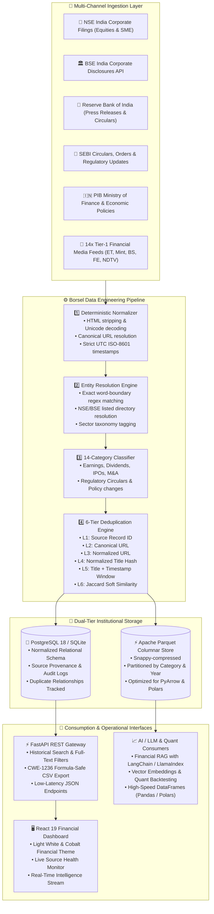

<div align="center">

# ⚡ Borsel Handler

### **Institutional AI-Powered Indian Financial Intelligence & Market Data Engineering Platform**

[](https://github.com/officialayush5839-arch/borsel-handler/actions)
[](LICENSE)
[](https://www.python.org/)
[](https://fastapi.tiangolo.com)
[](https://react.dev/)
[](https://www.postgresql.org/)
[](https://parquet.apache.org/)
[](docker-compose.yml)
[](docs/live_data_verification_report.md)
[-success?style=for-the-badge&logo=pytest&logoColor=white)](tests/)
[](SECURITY.md)
[](CONTRIBUTING.md)

<p align="center">
  <b>Automated ingestion, 6-tier cross-source deduplication, entity resolution, and historical analytical storage for NSE, BSE, RBI, SEBI, and PIB financial disclosures. Built for Quantitative Hedge Funds, Algorithmic Traders, and Financial RAG LLMs.</b>
</p>

[Key Features](#-key-features) •
[Architecture](#-system-architecture) •
[Quickstart](#-quickstart-in-60-seconds) •
[Data Coverage](#-data-source-coverage-matrix) •
[Live Verification Report](docs/live_data_verification_report.md) •
[AI & Quant Integration](#-downstream-ai--quant-pipeline-integration) •
[API Reference](#-rest-api-documentation) •
[Contributing](#-contributing)

---

</div>

## 📌 Executive Summary

The Indian financial ecosystem generates tens of thousands of corporate filings, regulatory circulars, and financial news items daily across fragmented, heterogeneous portals (NSE, BSE, RBI, SEBI, PIB, and major media publications). 

Downstream quantitative strategies, algorithmic trading systems, and LLM-based financial analysts face severe data engineering bottlenecks:
- **Severe Syndication & Duplicate Noise:** Up to 70% of financial news across portals consists of duplicate or syndicated wires.
- **Entity Ambiguity:** Company names in press releases frequently lack standardized exchange tickers (e.g., *"Tata Consultancy Services"* vs *"TCS"* vs *"TCS Ltd"*).
- **Heterogeneous & Fragile Schemas:** Unstructured HTML, varying timestamp formats, missing timezones, and ad-hoc payloads.
- **Lack of Analytical Storage:** Traditional relational databases struggle to feed vectorized LLM context windows and large-scale quantitative backtesting engines efficiently.

**Borsel Handler** is an end-to-end, production-tested financial data engineering platform that transforms this raw data flood into clean, deterministic, institutional-grade datasets stored simultaneously in **PostgreSQL** (for transactional queries) and **Apache Parquet** (for high-throughput vectorized AI/ML training and quantitative backtesting).

---

## 🏗️ System Architecture



---

## ✨ Key Features

- **⚡ Multi-Source Financial Ingestion:** Native, compliant connectors for NSE Equities, NSE SME, BSE India, RBI circulars, SEBI notifications, PIB economic policy, and 14 premier Indian business publications.
- **🎯 Institutional Entity Resolution:** Zero-subword false positives (`TCS`, `INFY`, `RELIANCE`, `HDFCBANK`) with strict word-boundary matching against 5,000+ listed Indian equities.
- **🔍 6-Tier Deduplication Engine:** Hierarchical deduplication covering exact source identifiers, canonical URLs, normalized content hashes, temporal-window matching, and soft-similarity detection.
- **📊 14-Class Financial Taxonomy:** Automated rule-based classification into Earnings & Results, IPO Listings, Dividends, Mergers & Acquisitions, Corporate Actions, Regulatory Circulars, and Economic Policies.
- **💾 Dual Storage Architecture:** Normalized PostgreSQL relational schema for live query serving coupled with high-throughput **Apache Parquet columnar archives** for high-speed AI/ML training and vectorized quantitative backtesting.
- **🛡️ Enterprise Security & Hardening:** 
  - Complete elimination of hardcoded secrets (100% environment-driven).
  - Strict protection against **Spreadsheet Formula Injection (CWE-1236)** across all CSV exports.
  - Safe, dialect-agnostic SQLAlchemy ORM preventing SQL injection.
- **🖥️ Sleek Financial UI:** Modern React 19 dashboard built with an institutional light white/cobalt blue palette, real-time metrics, search/filtering, and source-health telemetry.
- **🧪 100% Deterministic Testing:** 105 automated unit, integration, and end-to-end tests passing without any live external network dependency.

---

## 📊 Data Source Coverage Matrix

| Source Channel | Source Type | Category Covered | Official Endpoint / Target | Live Verification |
|---|---|---|---|:---:|
| **NSE India Equities** | `nse_announcement` | Exchange Filings & Corporate Actions | NSE Corporate Announcements API | ✅ Verified |
| **NSE India SME** | `nse_announcement` | SME Platform Disclosures | NSE Emerge Corporate Disclosures | ✅ Verified |
| **BSE India Announcements** | `bse_announcement` | Corporate Disclosures & XBRL | BSE Corporate Announcements API | ✅ Verified |
| **Reserve Bank of India (RBI)** | `rbi_circular` | Monetary Policy, Circulars & Notifications | RBI Official Press Releases & Circulars | ✅ Verified |
| **Securities and Exchange Board of India (SEBI)** | `sebi_regulation` | Regulatory Orders, Circulars & Rules | SEBI Official Regulatory Updates | ✅ Verified |
| **Press Information Bureau (PIB)** | `government_policy` | Economic Policies & Budget Announcements | PIB Ministry of Finance Newsdesk | ✅ Verified |
| **Economic Times** | `rss` | Markets & Corporate News | ET Prime & Markets RSS | ✅ Verified |
| **Mint (Livemint)** | `rss` | Companies, Economy & Policy | Mint Financial Wire RSS | ✅ Verified |
| **Business Standard** | `rss` | Markets & Industry | BS Markets RSS | ✅ Verified |
| **Financial Express** | `rss` | Economy & Market Intelligence | FE Industry & Markets RSS | ✅ Verified |
| **NDTV Profit / Business** | `rss` | Corporate News & Earnings | NDTV Profit Corporate Wire | ✅ Verified |
| **CNBC TV18** | `rss` | Breaking Business News | CNBC TV18 Markets Feed | ✅ Verified |

> [!TIP]
> **Empirical Live Ingestion Audit:** Read our comprehensive [Live Data Ingestion & Dynamic Collection Verification Report](docs/live_data_verification_report.md) with verifiable proofs, real-time disclosure URLs (NSE, RBI, SEBI, PIB, ET), dynamic deduplication stats, and reproduction commands.

---

## ⚡ Quickstart in 60 Seconds

### Option A: 1-Click Launch on Windows (`run.bat`)
Double-click `run.bat` in the project root or run from Command Prompt / PowerShell:

```cmd
run.bat
```
*Automatically runs Alembic migrations, starts FastAPI with localhost ingestion automation on port 8000, boots the React financial UI on port 5173, and launches your browser to `http://localhost:5173`!*

---

### Option B: 1-Click Launch with Docker Compose
Spin up PostgreSQL 16, the FastAPI backend, Alembic migrations, and the React frontend with a single command:

```bash
git clone https://github.com/officialayush5839-arch/borsel-handler.git
cd borsel-handler

# Start all microservices in background
docker compose up -d
```
- **React Financial Dashboard:** `http://localhost:5173`
- **FastAPI Backend & Docs:** `http://localhost:8000/docs`
- **PostgreSQL Database:** `localhost:5432` (`borsel_db`)

---

### Option C: Manual Local Setup (Python & Node)

#### Prerequisites
- **Python 3.11+** (Python 3.11, 3.12, 3.13, and 3.14 fully supported)
- **Node.js 20+** and npm 10+
- **PostgreSQL 14+** (Optional: defaults to SQLite for immediate zero-config local development)

#### 1. Clone & Setup Environment
```bash
git clone https://github.com/officialayush5839-arch/borsel-handler.git
cd borsel-handler

# Copy example environment configuration
cp .env.example .env
```

#### 2. Install Dependencies
```bash
# Backend dependencies
python -m venv .venv
source .venv/bin/activate  # On Windows: .venv\Scripts\activate
pip install -r requirements.txt

# Frontend dependencies
cd frontend
npm install
cd ..
```

#### 3. Initialize Database & Run Migrations
```bash
# Run versioned Alembic migrations
alembic upgrade head
```

#### 4. Start Backend Server & Frontend UI
In your first terminal (FastAPI Backend):
```bash
uvicorn borsel_handler.api.app:app --reload --host 0.0.0.0 --port 8000
```
*API is live at `http://localhost:8000` • Interactive Swagger UI at `http://localhost:8000/docs`*

In your second terminal (React 19 Frontend):
```bash
cd frontend
npm run dev
```
*Financial Dashboard is live at `http://localhost:5173`*

---

## 🤖 Downstream AI & Quant Pipeline Integration

Borsel Handler is built specifically for immediate consumption by Quantitative Finance and Financial LLM pipelines.

### High-Speed Analytical Loading via PyArrow & Polars
Export or stream data directly into high-performance columnar formats:

```python
import polars as pl
import pyarrow.parquet as pq

# 1. Read directly from Borsel Handler's Parquet Lake
df = pl.read_parquet("data/archive/financial_articles_2026.parquet")

# 2. Filter for earnings announcements mentioning Nifty 50 constituents
earnings_df = df.filter(
    (pl.col("category") == "Earnings & Results") & 
    (pl.col("company_symbols").list.contains("TCS"))
)

print(earnings_df.select(["title", "published_at", "original_url"]))
```

### Financial RAG with LangChain & LlamaIndex
Load pre-filtered, deduplicated corporate filings into your vector pipeline:

```python
import requests
from langchain_core.documents import Document

# Fetch clean, deduplicated announcements from Borsel Handler REST API
response = requests.get(
    "http://localhost:8000/api/v1/articles",
    params={"category": "SEBI Regulations & Circulars", "limit": 100}
)
articles = response.json().get("items", [])

# Convert to LangChain documents for Vector Store indexing (Chroma / Pinecone / pgvector)
docs = [
    Document(
        page_content=f"{a['title']}\n\n{a.get('summary', '')}",
        metadata={
            "source": a["source_name"],
            "url": a["original_url"],
            "published_at": a["published_at"],
            "companies": a.get("company_symbols", [])
        }
    )
    for a in articles
]
print(f"Indexed {len(docs)} high-signal regulatory filings.")
```

---

## 📡 REST API Documentation

Borsel Handler exposes high-throughput, low-latency REST endpoints documented via OpenAPI:

| Method | Endpoint | Description | Query Parameters |
|:---:|---|---|---|
| `GET` | `/health` | Health check & database connection probe | — |
| `GET` | `/api/v1/articles` | Filtered paginated list of financial articles | `q`, `category`, `source`, `symbol`, `page`, `limit` |
| `GET` | `/api/v1/articles/{id}` | Detailed article record with company & duplicate metadata | `id` (integer) |
| `GET` | `/api/v1/sources` | Status, error count, and health telemetry for all channels | — |
| `GET` | `/api/v1/stats` | Aggregated platform intelligence statistics | — |
| `POST` | `/api/v1/ingest/trigger` | Trigger immediate on-demand ingestion run | `cutoff_hours` (default: 48) |
| `GET` | `/api/v1/export/csv` | Export records in formula-safe CSV (CWE-1236 hardened) | Filter parameters |
| `GET` | `/api/v1/export/parquet` | Stream compressed Apache Parquet binary file | Filter parameters |

---

## 🧪 Testing & Verification

Borsel Handler maintains an exhaustive, 100% deterministic automated test suite:

```bash
# Execute full test suite (105 tests across 19 modules)
pytest -v

# Run deduplication engine tests
pytest tests/test_deduplication.py -v

# Run Alembic schema migration tests
pytest tests/test_alembic_migrations.py -v

# Run entity resolution & classification tests
pytest tests/test_taxonomies_and_resolvers.py -v

# Run security & CWE-1236 injection tests
pytest tests/test_expanded_validation.py -v
```

---

## 🏛️ Project Governance & Core Specs

Borsel Handler follows strict formal project specifications. Complete architectural and operational specifications are maintained directly in the repository root:

- [`prd.md`](prd.md) — Product Requirements Document (REQ-01 to REQ-25).
- [`architecture.md`](architecture.md) — Complete Technical Architecture & Dataflow Diagrams.
- [`rules.md`](rules.md) — Mandatory Engineering, Security & Data Governance Rules.
- [`phases.md`](phases.md) — Implementation Roadmap & Milestones.
- [`memory.md`](memory.md) — Persistent Project Context, Commit Provenance & Decisions.
- [`goal.md`](goal.md) — Measurable Objectives & Target Thresholds.
- [`task.md`](task.md) — Complete 41-Task Granular Implementation Ledger.

---

## 🤝 Contributing

We welcome contributions from quantitative developers, data engineers, and AI researchers! Please see [`CONTRIBUTING.md`](CONTRIBUTING.md) for development setup and contribution guidelines.

1. Fork the Project
2. Create your Feature Branch (`git checkout -b feat/AmazingFeature`)
3. Commit your Changes (`git commit -m 'feat: add support for MCX commodity feed'`)
4. Push to the Branch (`git push origin feat/AmazingFeature`)
5. Open a Pull Request

---

## 📜 License & Citation

Distributed under the **MIT License**. See [`LICENSE`](LICENSE) for details.

If you use Borsel Handler in your quantitative research, academic paper, or financial engineering project, please cite:

```bibtex
@software{borsel_handler_2026,
  author = {Vishwakarma, Ayush},
  title = {Borsel Handler: AI-Powered Indian Financial Intelligence and Market Data Engineering Platform},
  year = {2026},
  publisher = {GitHub},
  url = {https://github.com/officialayush5839-arch/borsel-handler}
}
```

<div align="center">
  <b>⭐ Star us on GitHub if Borsel Handler accelerates your financial intelligence pipeline! ⭐</b>
</div>
