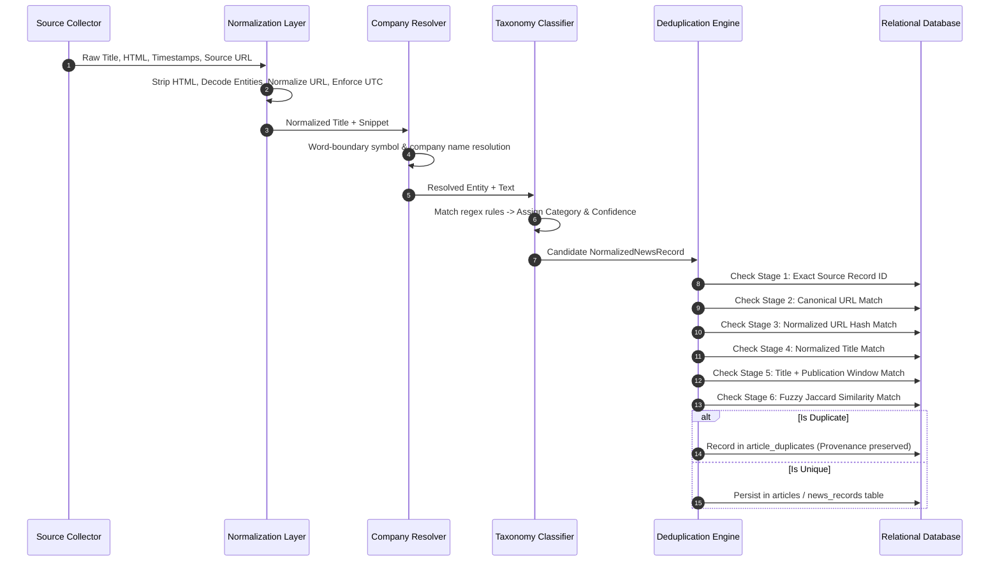
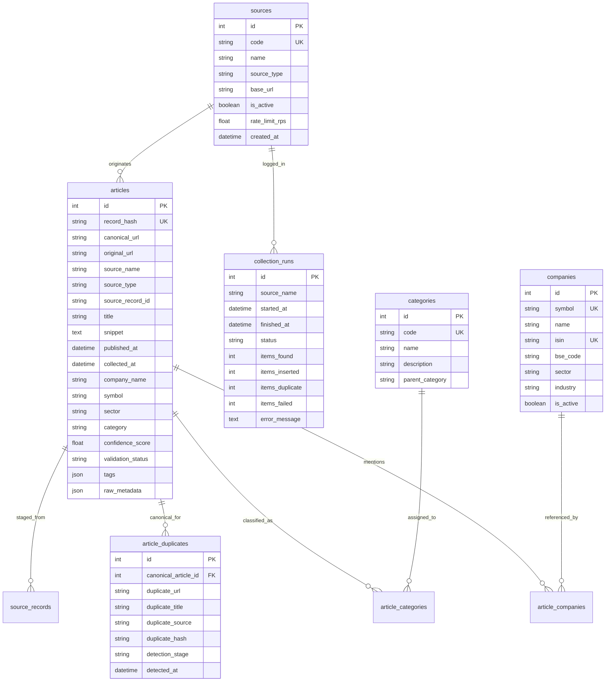

# Borsel Handler — Technical Architecture

**Document ID:** ARCH-2026-BH  
**Version:** 2.0.0  
**Effective Date:** 2026-10-19  
**Status:** Approved for Implementation  
**Project:** Borsel Handler — AI-Powered Indian Stock Market Intelligence Platform

---

## 1. System Overview

Borsel Handler is structured as a decoupled, modular financial data engineering platform consisting of four primary subsystems:
1. **Multi-Source Collector Subsystem:** Pluggable connectors for RSS news, exchange announcements (BSE & NSE), regulatory updates (RBI & SEBI), and government economic policies (PIB).
2. **Shared Ingestion Pipeline:** Sanitization, normalization, company entity resolution, sector mapping, event classification, and multi-tier deduplication.
3. **Storage & Persistence Subsystem:** Dual-dialect SQLAlchemy 2.0 ORM with PostgreSQL (production) and SQLite (testing), managed by Alembic database migrations.
4. **API & Interface Subsystem:** Asynchronous FastAPI service serving REST endpoints and background runner tasks, consumed by a React 18 single-page application.

```mermaid
flowchart TD
    subgraph Sources [External Financial Sources]
        RSS[Financial RSS Feeds]
        BSE[BSE Corporate Disclosures]
        NSE[NSE Equities & SME API]
        RBI[Reserve Bank of India]
        SEBI[SEBI Regulatory Circulars]
        PIB[PIB Economic Policies]
    end

    subgraph Ingestion [Unified Ingestion Framework]
        BC[BaseCollector Interface]
        NORM[Normalization & URL Canonicalization Layer]
        COMP[Company & Sector Resolver]
        CLASS[Rule-Based Taxonomy Classifier]
        DEDUP[Multi-Stage Deduplication Engine]
    end

    subgraph Persistence [Storage Subsystem]
        ALEMBIC[Alembic Migrations]
        PG[(PostgreSQL / SQLite DB)]
        subgraph Tables [Relational Entities]
            SRC[sources]
            ART[articles / news_records]
            COMP_T[companies]
            CAT_T[categories]
            RUNS[collection_runs / collection_logs]
            DUPS[article_duplicates]
        end
    end

    subgraph API [FastAPI Service Layer]
        EP_REC[/api/v1/records]
        EP_SRC[/api/v1/sources]
        EP_STAT[/api/v1/stats]
        EP_TRIG[/api/v1/ingest/trigger]
        BG[Async Background Scheduler]
    end

    subgraph Frontend [React 18 SPA]
        UI[Light Blue / Clean White UI]
        FILTER[Company / Sector / Source / Date Filters]
        HEALTH[Source Health & Run Metrics]
        SEARCH[Historical Keyword Search]
    end

    RSS --> BC
    BSE --> BC
    NSE --> BC
    RBI --> BC
    SEBI --> BC
    PIB --> BC

    BC --> NORM
    NORM --> COMP
    COMP --> CLASS
    CLASS --> DEDUP
    DEDUP -->|Unique Articles| ART
    DEDUP -->|Duplicate Evidence| DUPS
    DEDUP --> SRC
    DEDUP --> COMP_T
    DEDUP --> CAT_T
    DEDUP --> RUNS

    ALEMBIC --> PG
    Tables --> PG

    PG --> API
    BG --> Ingestion
    API --> Frontend
```

---

## 2. Technology Stack & Repository Reuse Decisions

### 2.1 Technology Stack
- **Runtime Environment:** Python 3.11+ / Python 3.14 compatible. Node.js v20+ for frontend.
- **Backend Framework:** FastAPI 0.115+, Starlette, Uvicorn, Pydantic v2.
- **Database & ORM:** PostgreSQL (production), SQLite (local dev/test), SQLAlchemy 2.0 ORM.
- **Database Migrations:** Alembic 1.18+.
- **HTTP Client & Parsing:** `httpx` (async), `feedparser`, `lxml`, standard `urllib`.
- **Frontend Framework:** React 18, Vite 5, TypeScript, Tailwind CSS.
- **Test Framework:** Pytest 8+, `pytest-asyncio`, `pytest-mock`, local JSON/XML fixtures.

### 2.2 Upstream Repository Reuse Analysis
| Component | StockPulse Origin | Market Announcements Origin | Borsel Handler Decision |
|---|---|---|---|
| **App Architecture** | FastAPI + React SPA | Monolithic CLI + Streamlit | Reused StockPulse FastAPI structure as unified service foundation. |
| **RSS Ingestion** | Curated 14 RSS Feeds | Absent | Adapted and enhanced with strict canonical URL normalization. |
| **BSE Ingestion** | JSON API caller | API & HTML scrapers | Unified into `BSEAnnouncementCollector` with attachment link resolution. |
| **NSE Ingestion** | Absent | Session-authenticated scraper | Adapted into `NSEAnnouncementCollector` supporting Equities and SME. |
| **RBI, SEBI, PIB** | Partial keyword match | Fragmented rules | Implemented dedicated collectors adhering to `BaseCollector`. |
| **Classification** | Basic heuristic | Rich keyword weights | Unified into deterministic 12-category taxonomy classifier. |
| **Entity Mapping** | Nifty 50 dictionary | Raw script codes | Implemented `CompanyResolver` with multi-entity detection and sectors. |
| **Deduplication** | In-memory hash | SQLite `INSERT OR IGNORE` | Implemented centralized 6-stage deduplication engine with duplicate provenance. |
| **Storage** | None (in-memory cache) | 4 SQLite databases | Unified relational schema managed by Alembic. |

---

## 3. Component Architecture & Ingestion Lifecycle

### 3.1 Source Connector Interface (`BaseCollector`)
Every connector inherits from `borsel_handler.collectors.base.BaseCollector`:
```python
class BaseCollector(ABC):
    @property
    @abstractmethod
    def source_name(self) -> str: ...

    @property
    @abstractmethod
    def source_type(self) -> str: ...

    @abstractmethod
    async def fetch(self, cutoff: Optional[datetime] = None) -> List[NormalizedNewsRecord]: ...
```
Connectors are responsible only for network retrieval, handling source rate limits, parsing raw payloads, and emitting standard `NormalizedNewsRecord` instances. All downstream persistence, deduplication, and cross-source mapping are handled by the shared pipeline.

### 3.2 Ingestion & Deduplication Pipeline


---

## 4. Relational Database Schema Design

The persistence tier implements a clean third-normal-form relational model while providing backward-compatible aliases for existing API consumers:



---

## 5. Background Collection & Recovery Flow

To guarantee system resilience under real-world network instability:
1. **Exponential Backoff with Jitter:** Connectors encountering transient network errors (HTTP 429, 502, 503, connection timeouts) retry with formula:  
   $t_{wait} = \min(t_{max}, t_{base} \times 2^{\text{attempt}} + \text{uniform}(0, 1))$.
2. **Graceful Degradation:** An error in one collector logs the failure into `collection_runs`, updates source health status, and allows all other collectors to proceed uninterrupted.
3. **Overlapping Job Prevention:** Asynchronous collection runs use an atomic lock state to prevent overlapping executions for the same source.
4. **Restart Idempotence:** Because deduplication occurs across source record IDs and URL/title fingerprints, interrupted or repeated runs never create duplicate rows.

---

## 6. Frontend Architecture & Visual Specification

### 6.1 Theme & Design System
- **Palette:** Institutional financial theme — Clean White background (`#ffffff`), Slate Gray borders (`#e2e8f0`), Crisp Sky/Navy Blue accents (`#0284c7`, `#0369a1`), and Soft Blue highlights (`#e0f2fe`).
- **Typography:** High-contrast Inter / System Sans-Serif font hierarchy for rapid visual scanning.
- **Anti-Pattern Rejection:** Avoids illegible black neon themes, heavy glassmorphism, and unstyled raw JSON outputs.

### 6.2 Key Views
- **Header / Navigation:** System status indicator, total articles indexed, active source count.
- **Search & Filter Panel:** Live symbol dropdown (Nifty 50 + search), sector filter, source selector, category taxonomy selector, and time window selector (24h, 48h, 72h, 1w, 2w, all).
- **News & Announcements Feed:** High-density cards displaying publication timestamp, source badge, category badge, symbol ticker, snippet, and external link.
- **Article Details Modal:** Complete inspection of canonical URL, original URL, classification confidence score, metadata tags, and provenance audit data.
- **Operations & Source Health Dashboard:** Visual table of all 7 source channels, last successful run timestamp, error messages, and manual trigger action with loading spinner.

---

## 7. Security Boundaries & Configuration

1. **Environment-Driven Configuration:** All database connection strings, API keys, and environment toggles are driven by `borsel_handler/config.py` using `pydantic-settings`.
2. **Safe Logging:** Logging scrubbers prevent writing API tokens or credentials into application log streams.
3. **Access Controls:** Mutation endpoints (`POST /api/v1/records`, `POST /api/v1/ingest/trigger`) validate input payloads with Pydantic and support optional API token validation (`x-api-key` / `x-site-password`).
4. **SQL Injection Prevention:** All database operations strictly employ SQLAlchemy 2.0 ORM and parameterized query builders; zero raw unparameterized SQL strings.
